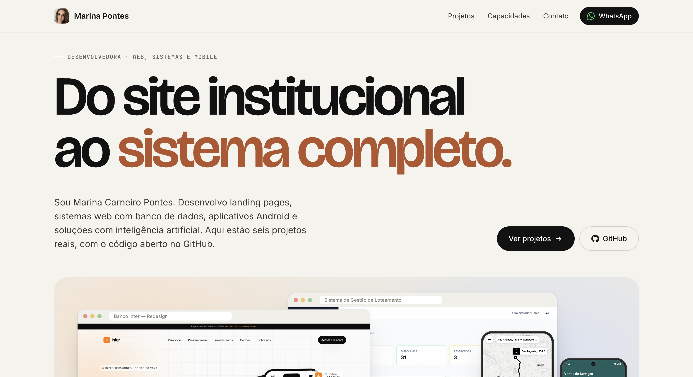
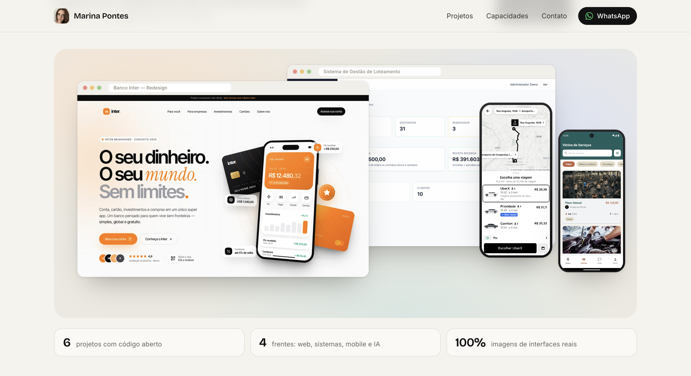
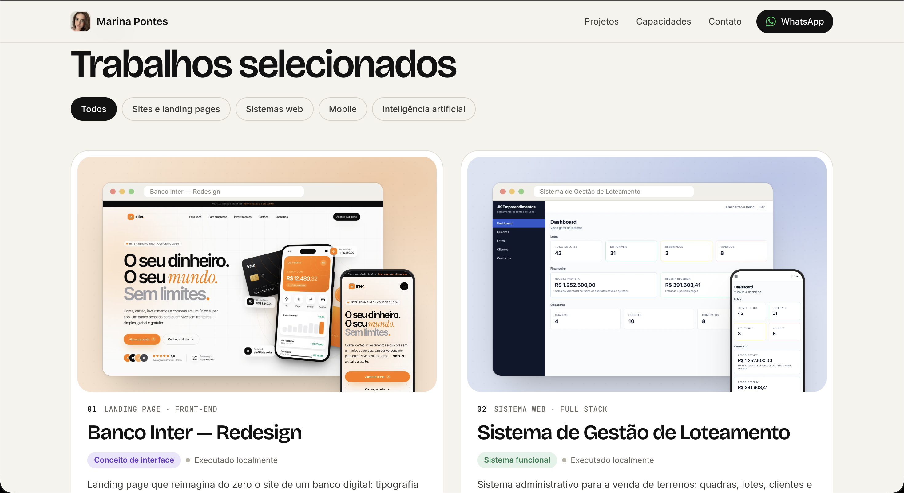
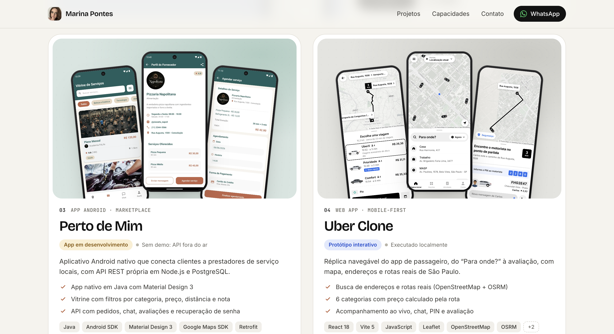
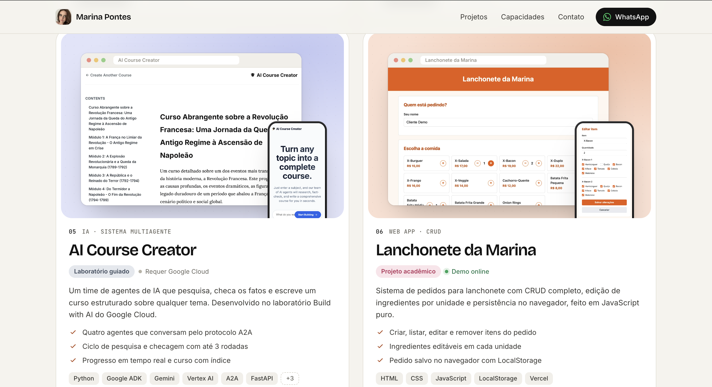

<h1 align="center">
   
  Meu Portfólio
   
</h1>

  Uma seleção dos projetos que desenvolvo, com o objetivo, as funcionalidades e os destaques técnicos de cada um.

  
  
  
  

  

---

## Sobre

Reúno aqui meus trabalhos em web, sistemas, mobile e inteligência artificial. Cada projeto tem uma página própria com objetivo, funcionalidades, destaques técnicos, galeria de telas e link para o código.

O portfólio foi pensado para ser **transparente sobre o que cada projeto é**:

- **Selo de tipo**: sistema funcional, app em desenvolvimento, protótipo interativo, conceito de interface, laboratório guiado ou projeto acadêmico.
- **Selo de status**: se há demo online, se roda só localmente ou o que impede a execução.
- **Imagens reais**: capturas das interfaces rodando, sem retoques. Cada página termina com uma nota explicando a origem das imagens e os limites do projeto.

---

## Telas

<table align="center">
  <tr>
    <td align="center">
Destaque
</td>
    <td align="center">
Trabalhos selecionados
</td>
  </tr>
  <tr>
    <td align="center">
Mobile
</td>
    <td align="center">
IA e web
</td>
  </tr>
</table>

---

## Projetos

| Projeto | Tipo | Stack principal | Links |
|---|---|---|---|
| **Banco Inter — Redesign** | Conceito de interface | React, Vite, Tailwind CSS | [código](https://github.com/marinacpontes/bancointersite) |
| **Sistema de Gestão de Loteamento** | Sistema funcional | TypeScript, React, Express, Prisma, PostgreSQL | [código](https://github.com/marinacpontes/sistemaimobiliaria) |
| **Perto de Mim** | App em desenvolvimento | Java/Android, Node.js, PostgreSQL | [código](https://github.com/marinacpontes/pertodemim) |
| **Uber Clone** | Protótipo interativo | React, Leaflet, OpenStreetMap, OSRM | [código](https://github.com/marinacpontes/uberclone) |
| **AI Course Creator** | Laboratório guiado | Python, Google ADK, Gemini, A2A | [código](https://github.com/marinacpontes/buildwithai) |
| **Lanchonete da Marina** | Projeto acadêmico | HTML, CSS, JavaScript | [código](https://github.com/marinacpontes/lanchonetesistema) · [demo](https://lanchonetesistema.vercel.app/) |